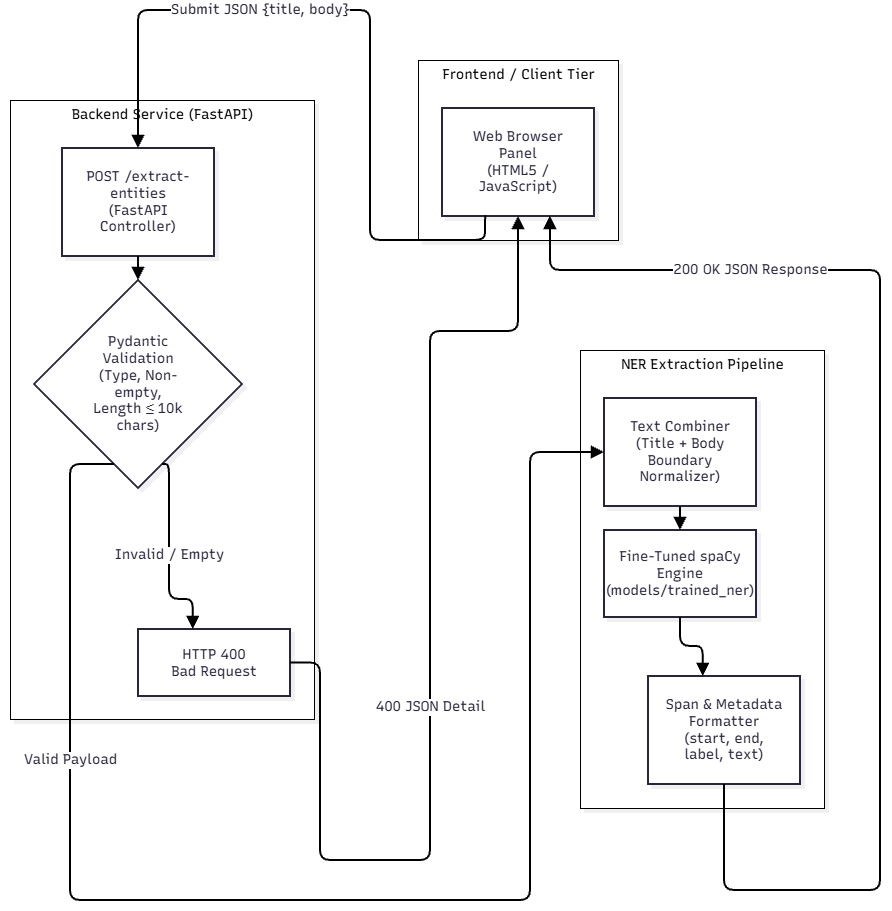

# Named Entity Recognition Service for News Articles


Layanan NER (Named Entity Recognition) untuk artikel berita finansial berbasis FastAPI dan spaCy.

## Architecture



## Prerequisites

* Python 3.10 atau lebih baru
* pip
* Virtual environment

## Installation

```bash
python -m venv venv
venv\Scripts\activate

pip install -r requirements.txt
python -m spacy download en_core_web_sm
```

## Data Processing

Cleaning data mentah dan pembentukan dataset teranotasi dijalankan dengan urutan:

```bash
python src/profile_data.py
python src/prepare_dataset.py
```

## Model Training

Adaptasi komponen NER terhadap domain berita finansial dijalankan melalui:

```bash
python src/train_and_eval.py
```

## Running the Web Service

Jalankan server lokal dengan uvicorn:

```bash
uvicorn src.app:app --reload --port 8000
```

Web UI dapat diakses di `http://127.0.0.1:8000`.

## Automated Testing

```bash
pytest tests/test_api.py
```

## API Reference

### Request

Endpoint: `POST /extract-entities` dengan body JSON:

```json
{
  "title": "UOB Malaysia and Maybank complete landmark transaction",
  "body": "UOB Malaysia, RHB Banking Group and Maybank completed a financial transaction in Kuala Lumpur on Monday."
}
```

Ketentuan input:

* `title` dan `body` wajib berupa string
* Tidak boleh kosong atau hanya berisi whitespace
* Maksimal 10.000 karakter

### Response

Request yang lolos validasi mengembalikan HTTP 200:

```json
{
  "entities": [
    {
      "text": "UOB Malaysia",
      "label": "ORG",
      "start": 0,
      "end": 12
    },
    {
      "text": "Maybank",
      "label": "ORG",
      "start": 17,
      "end": 24
    },
    {
      "text": "Kuala Lumpur",
      "label": "GPE",
      "start": 139,
      "end": 151
    }
  ],
  "meta": {
    "entity_count": 3,
    "model": "models/trained_ner",
    "combined_length": 162
  }
}
```

Jika format tidak valid atau input kosong, server mengembalikan HTTP 400 beserta detail error.

## Data Split

Dataset dibagi 70% train, 15% validation, dan 15% test. Split dilakukan berdasarkan article ID unik dengan random seed `42` untuk mencegah data leakage antar partisi.

## Evaluation Results

Evaluasi menggunakan exact-span matching pada test set yang belum pernah dilihat model selama training.

| Metric | Baseline (`en_core_web_sm`) | Fine-tuned (`models/trained_ner`) |
| :--- | :--- | :--- |
| **Overall Precision** | 0.8571 | 0.8636 |
| **Overall Recall** | 0.8571 | 0.9048 |
| **Overall F1** | 0.8571 | 0.8837 |
| *F1 ORG* | 0.9100 | 0.9600 |
| *F1 GPE* | 0.8900 | 0.8900 |
| *F1 PERSON* | 1.0000 | 1.0000 |
| *F1 DATE* | 1.0000 | 1.0000 |
| *F1 LOC* | 0.5000 | 0.5000 |

## Error Analysis

* **Local honorific boundaries**
  Span nama seperti "Tan Sri Razarudin Husain" sering terpotong menjadi "Razarudin Husain". Model dasar berbahasa Inggris cenderung memperlakukan gelar kehormatan Melayu sebagai kata di luar entitas.
* **Company suffix variation**
  Exact-span matching gagal ketika model mengekstraksi "RHB Bank" sementara label acuan adalah "RHB Bank Berhad". Ketidakkonsistenan suffix badan hukum menghasilkan penalti ganda pada precision dan recall.
* **Code-switching interference**
  Kalimat yang mencampur Bahasa Melayu dan Inggris membingungkan model, sehingga nama divisi korporasi tidak terdeteksi karena vocabulary bawaan tidak mencakup morfologi lokal.

## Named Entity Definition

Sebuah span teks dianggap named entity jika merujuk pada objek dunia nyata yang spesifik melalui nama diri. Entitas dikelompokkan ke dalam kategori semantik: organisasi, wilayah administratif, individu, dan tanggal.

## Why Title and Body Are Combined

Judul dan isi diproses bersama agar konteks diskursus tetap utuh. Judul berita biasanya memuat akronim singkat tanpa penjelasan, sedangkan bentuk lengkap entitas biasanya muncul di paragraf pembuka. Pemrosesan terpisah menghilangkan relasi koreferensi antar bagian teks.

## Supported Entity Types

* **ORG**: bank, konglomerasi industri, dan otoritas regulator moneter
* **GPE**: negara, provinsi, dan kota
* **LOC**: kawasan geografis non-politik atau bangunan fisik
* **PERSON**: pejabat publik, direksi bank, dan pengambil kebijakan korporasi
* **DATE**: nama hari, bulan, dan tahun

## Linguistic Factors

* **Punctuation**
  Nama yang memuat ampersand atau titik singkatan memerlukan tokenization yang konsisten agar batas karakter tidak terfragmentasi.
* **Capitalization**
  Pola title case adalah sinyal utama pembeda entitas. Judul dengan huruf kapital penuh menurunkan sensitivitas model secara drastis.
* **Language variation**
  Representasi vektor bahasa Inggris tidak mencakup afiksasi Bahasa Melayu, sehingga konteks gramatikal lokal gagal terbaca.

## Output Components

* **text**: karakter persis seperti tertulis pada artikel sumber
* **label**: kelas semantik yang mewakili peran entitas
* **start / end**: indeks karakter berbasis nol pada teks gabungan (title + body)

## Repeated Mentions

Setiap kemunculan kata yang sama diekstraksi sebagai instance terpisah berdasarkan posisinya. Penulisan dengan kapitalisasi berbeda dicatat sebagai span terpisah. Penyatuan mention menjadi satu identitas kanonikal memerlukan modul entity linking tersendiri.

## Improvement Priorities for Media Monitoring

Kegagalan mendeteksi institusi dan eksekutif kunci adalah error paling merugikan dalam media monitoring, karena analisis eksposur risiko pasar menjadi tidak akurat. Akurasi dapat ditingkatkan melalui:

* Integrasi gazetteer perusahaan tercatat di bursa efek lokal
* Penggunaan model transformer bilingual
* Perluasan korpus anotasi

## Ethics and Regulatory Considerations

* **Copyright**
  Menyimpan teks artikel berita secara utuh tanpa lisensi dapat melanggar hak eksklusif penerbit.
* **Privacy**
  Pengindeksan otomatis nama warga dalam berita perkara hukum menyentuh kepatuhan terhadap undang-undang pelindungan data pribadi.
* **Training corpus bias**
  Model dasar yang didominasi korpus berita Barat memiliki akurasi lebih rendah pada nama tokoh dan struktur kelembagaan Asia Tenggara.

## Limitations

* Pipeline dioptimalkan untuk teks berbahasa Inggris, sehingga performa menurun pada teks Bahasa Melayu murni.
* Exact-span matching sangat sensitif terhadap inkonsistensi penulisan bentuk badan usaha.
* Batas memori membatasi input maksimal 10.000 karakter per request.
